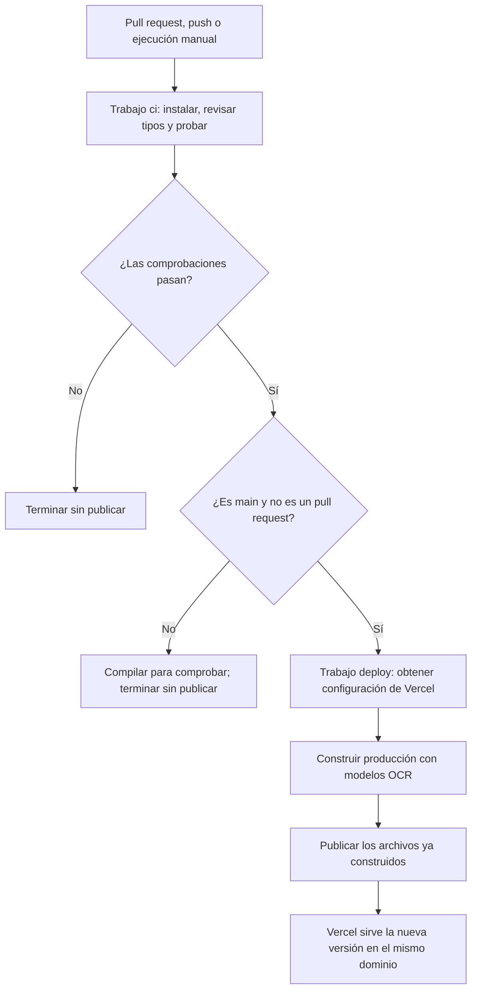

# CI/CD de Get an Epub

El pipeline revisa el código al recibir cambios y publica la rama `main` en Vercel solo cuando pasan las comprobaciones. El dominio de GoDaddy apunta a Vercel; no interviene en cada actualización.

## Qué significan CI y CD

**CI, integración continua**, comprueba que los cambios siguen siendo compatibles con el proyecto. Aquí instala las dependencias, revisa Astro y TypeScript y ejecuta las pruebas unitarias. En los pull requests también compila la web, incluidos los motores y los modelos OCR.

**CD, despliegue continuo**, publica la aplicación después de superar CI. En este proyecto, un push a `main` construye la versión de producción y la despliega en Vercel. También se puede iniciar el proceso con el botón Run workflow. Si solo se publicara después de una aprobación manual, hablaríamos de entrega continua con un paso manual de despliegue.

## Archivos que participan

```text
.github/
└── workflows/
    └── ci-cd.yml             Eventos, trabajos, comandos y conexión con Vercel
vercel.json                  Cómo construir, qué carpeta servir y sus cabeceras
package.json                 Comandos del proyecto y versiones de dependencias
package-lock.json            Dependencias fijadas para npm ci
scripts/
├── download-ocr.mjs          Descarga y verifica los modelos OCR
├── prepare-assets.mjs        Prepara los motores, fuentes y licencias
└── security-headers.mjs      Genera build/public y build/private
docs/
└── CI_CD.md                 Esta explicación
```

GitHub busca los workflows en `.github/workflows/`. Un YAML guardado en otra carpeta, por ejemplo `release/`, no activa Actions.

## Flujo



## Estructura del YAML

| Bloque | Para qué sirve en este proyecto |
| --- | --- |
| `name` | Nombre que aparece en la pestaña Actions. |
| `on` | Eventos que arrancan el pipeline: pull request, push a main o botón manual. |
| `permissions` | Permisos del token temporal de GitHub; solo necesita leer el repositorio. No sustituye el token de Vercel. |
| `concurrency` | Agrupa ejecuciones de la misma rama para controlar la concurrencia. |
| `env` | Valores comunes: Node no envía telemetría de Astro y la publicidad queda desactivada. |
| `jobs` | Los dos trabajos: `ci` y `deploy`. |
| `runs-on` | Máquina temporal de GitHub donde corre cada trabajo; aquí Ubuntu. |
| `timeout-minutes` | Límite de duración para que una ejecución no quede funcionando indefinidamente. |
| `steps` | Pasos que se ejecutan en orden dentro de un trabajo. |
| `uses` | Una acción reutilizable, como descargar el código o instalar Node. |
| `with` | Parámetros de esa acción: versión de Node, caché de npm, etc. |
| `run` | Un comando que ejecuta el runner. |
| `if` | Condición que decide si se ejecuta un paso o un trabajo. |
| `needs: ci` | Impide que `deploy` empiece hasta que `ci` termine correctamente. |
| `secrets` | Referencias a valores guardados en GitHub; sus valores no se escriben en el YAML. |

Un **workflow** es el archivo completo. Un **job** es un trabajo en su propia máquina temporal. Un **step** es un paso dentro del trabajo. Los jobs no comparten automáticamente sus archivos: por eso `deploy` descarga de nuevo el mismo commit que validó `ci`.

## Trabajo ci: revisar el código

1. `actions/checkout` descarga el commit asociado a la ejecución. No descarga silenciosamente un commit nuevo si subes cambios mientras la ejecución está en curso.
2. `actions/setup-node` prepara Node 24 y la caché de descargas de npm.
3. `npm ci` instala exactamente las dependencias de `package-lock.json`. Si ese archivo no corresponde a `package.json`, falla.
4. `npm run check` comprueba Astro y TypeScript.
5. `npm test` ejecuta las pruebas unitarias existentes.
6. Si es un pull request o una ejecución manual fuera de `main`, `npm run setup && npm run build` descarga/verifica los modelos, prepara recursos y comprueba la compilación, sin publicar.

Para un push a `main`, la compilación ocurre en `deploy`, con la configuración de producción. Así no se compila dos veces en la misma ejecución.

## Trabajo deploy: construir y publicar

Solo se ejecuta si pasa `ci`, la rama es `main` y el evento no es `pull_request`.

1. Descarga el mismo commit y prepara Node 24.
2. Comprueba que existen los tres secrets de Vercel. Si falta alguno, el mensaje indica cuál.
3. Instala la CLI oficial de Vercel.
4. `vercel pull --environment=production` obtiene la configuración y las variables del proyecto de Vercel.
5. `vercel build --prod` construye la aplicación dentro del runner. Usa el build command de `vercel.json`: `npm run setup && npm run build`. La salida pública del proyecto es `build/public`; la CLI prepara además `.vercel/output` en el formato de Vercel.
6. `vercel deploy --prebuilt --prod` publica esa construcción. `--prebuilt` evita reconstruirla otra vez en los servidores de Vercel.
7. Guarda la URL resultante en el resumen de la ejecución de GitHub Actions.

Si falla la construcción o la carga, Actions muestra el fallo. El resultado definitivo de una publicación debe comprobarse en Actions y en Vercel; un trabajo empezado todavía no significa una versión publicada.

## Credenciales y configuración

En GitHub: Settings → Secrets and variables → Actions.

| Secret | Valor |
| --- | --- |
| `VERCEL_TOKEN` | Token de Vercel con acceso al equipo donde vive este proyecto. |
| `VERCEL_ORG_ID` | ID del equipo o cuenta de Vercel; corresponde a `orgId`. |
| `VERCEL_PROJECT_ID` | ID del proyecto de Vercel; corresponde a `projectId`. |

Los IDs se consultan en los ajustes del proyecto o en `.vercel/project.json` después de ejecutar `vercel link`. El token se crea y administra en la configuración de la cuenta de Vercel. Si vence o se revoca, hay que actualizar el secret de GitHub.

El token de Vercel solo se entrega a los pasos de despliegue que lo necesitan. Los pull requests ejecutan CI sin acceder a ese token. `.vercel/`, los archivos de entorno locales y la URL temporal de despliegue están excluidos de Git. Los PDF de los visitantes siguen procesándose en su navegador; no forman parte de los artefactos ni de las pruebas de este pipeline.

`vercel.json` conserva cabeceras diferentes para la página pública y para `/convert`, `/engine` y `/ocr`. Desactiva los despliegues automáticos de la integración Git de Vercel para que la publicación dependa de Actions. Esta instalación está preparada para un solo origen y publicidad desactivada; activar anuncios requiere revisar la separación de hosts y las cabeceras, según `ADVERTISING.md`.

## Qué pasa con tus siguientes commits

| Acción | Resultado |
| --- | --- |
| Abrir o actualizar un pull request hacia main | CI revisa, prueba y compila. No publica. |
| Hacer push o fusionar un pull request en main | CI revisa y prueba; si pasa, deploy construye y publica. |
| Actions → CI y deploy a Vercel → Run workflow → main | Ejecuta comprobaciones y publicación manual. |
| Ejecutar manualmente otra rama | Revisa, prueba y compila sin publicar. |

El botón manual aparece cuando el workflow existe en la rama predeterminada del repositorio. Las ejecuciones en otras ramas se pueden cancelar cuando llega una más reciente. En `main` no se cancela automáticamente una publicación en curso; GitHub mantiene como máximo una ejecución activa y una pendiente en el grupo, y puede sustituir pendientes por cambios más recientes. Esto evita ejecutar dos despliegues de esta rama a la vez desde este workflow, pero no sustituye controles sobre otros workflows o despliegues manuales externos.

Para publicar únicamente con el botón, elimina el bloque `push` y conserva `pull_request` y `workflow_dispatch`. El workflow asume que tu rama de producción se llama `main`; si cambias el nombre, cambia tanto `branches` como las condiciones `refs/heads/main`.

## Cómo leer un fallo

En GitHub abre Actions, selecciona la ejecución y expande el paso rojo.

- Falla `npm ci`: comprueba el lockfile, la disponibilidad de las dependencias y la versión de Node.
- Falla Astro/TypeScript o una prueba: corrige el error indicado y sube otro commit.
- Falla setup: revisa el acceso a la descarga de modelos OCR y su verificación SHA-256.
- Falta un secret: completa la conexión con Vercel; el job de CI sigue siendo independiente.
- Falla autenticación de Vercel: revisa el token, su vencimiento y el equipo/proyecto seleccionados.
- Pasa el despliegue pero falla el dominio: revisa el DNS y HTTPS en Vercel/GoDaddy. No es un fallo de compilación.

Que CI falle evita publicar desde este workflow. Para impedir también fusionar un pull request con CI fallida, configura una regla de rama de GitHub que exija la comprobación `Revisar código y pruebas`. Esa regla es independiente del YAML.

## Alcance y mantenimiento

El pipeline actual comprueba tipos, pruebas unitarias y compilación. Las pruebas de navegador, idioma, seguridad de dos orígenes y EPUBCheck existen en el proyecto, pero no están incluidas en esta primera automatización. Requieren preparar navegador, documentos sintéticos y, para EPUBCheck, Java. Una compilación correcta no garantiza fidelidad de todos los PDF ni valida por sí sola las cabeceras del alojamiento real.

Las versiones de las dependencias de la aplicación se fijan con el lockfile. El workflow usa las versiones mayores oficiales indicadas de checkout/setup-node e instala la CLI más reciente de Vercel. Fijar esa CLI a una versión concreta, o las acciones a sus SHA, permite un control más estricto de las actualizaciones si lo necesitas posteriormente.

## Referencias oficiales

- [GitHub Actions con Vercel](https://vercel.com/kb/guide/how-can-i-use-github-actions-with-vercel)
- [Configuración de Vercel](https://vercel.com/docs/project-configuration/vercel-json)
- [Control de despliegues de la integración Git](https://vercel.com/docs/project-configuration/git-configuration)
- [Ejecución manual de workflows](https://docs.github.com/en/actions/how-tos/manage-workflow-runs/manually-run-a-workflow)
